<h2>
  <picture>
    <source media="(prefers-color-scheme: dark)" srcset="./assets/heading-featured-projects-dark.svg">
    
  </picture>
</h2>

  
  

  
  

<h2>
  <picture>
    <source media="(prefers-color-scheme: dark)" srcset="./assets/heading-stack-dark.svg">
    
  </picture>
</h2>

<h2>
  <picture>
    <source media="(prefers-color-scheme: dark)" srcset="https://raw.githubusercontent.com/Banasri007/Banasri007/output/arcade.svg">
    
  </picture>
</h2>

<!-- SOCIAL_PLACEHOLDERS
[Portfolio](YOUR_PORTFOLIO_URL) · [Kaggle](YOUR_KAGGLE_URL)
Replace values and remove this comment wrapper and this sentence when ready.
-->

  
  &nbsp;
  

